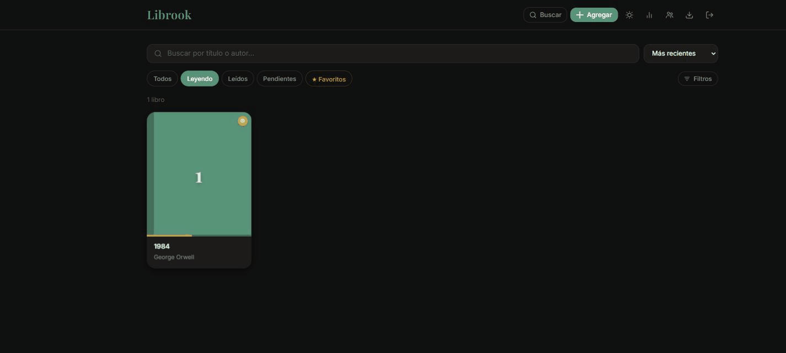
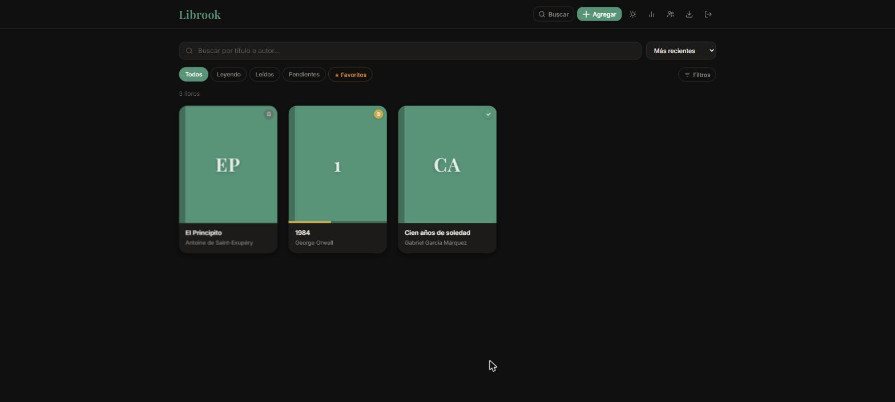
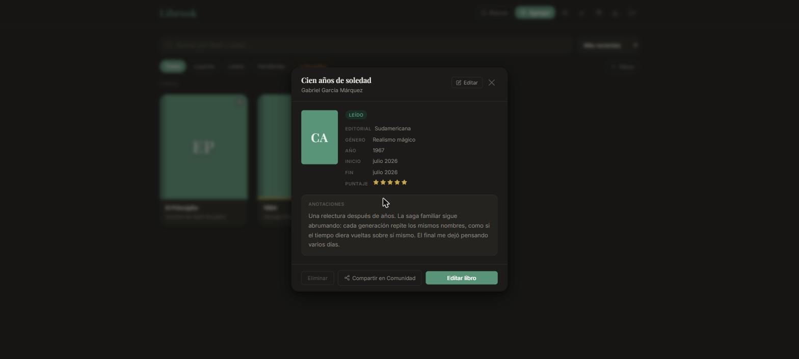
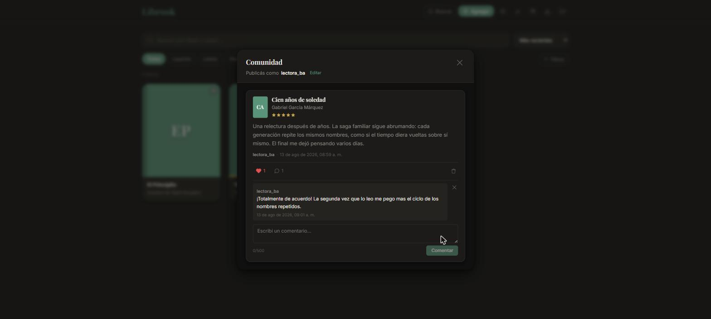
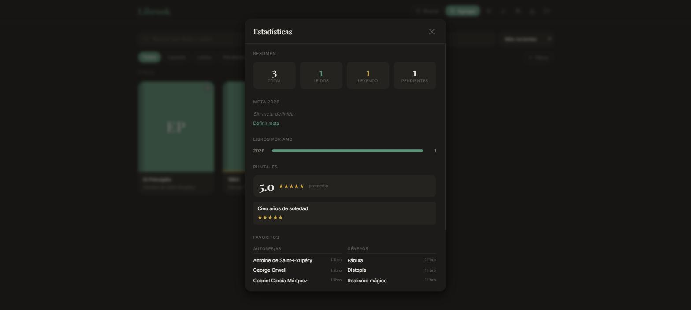

# Haiku — Biblioteca personal de libros



Aplicación full-stack para llevar tu biblioteca de libros: qué leíste, qué estás leyendo y qué
tenés pendiente, con búsqueda de catálogo real vía OpenLibrary y escaneo de ISBN por cámara.
Incluye una sección de comunidad para compartir reflexiones sobre lo leído con otros usuarios.
PWA instalable, con modo oscuro y diseño propio.

## El problema que resuelve

Las listas de "libros para leer" sueltas en notas o apps genéricas se pierden fácil y no
registran nada del recorrido de lectura. Haiku da un lugar propio para toda la biblioteca,
con datos reales del libro (portada, autor/a, editorial, año) traídos de OpenLibrary al
agregarlo, seguimiento de página actual, puntaje en estrellas, notas y fechas de inicio/fin —
y la posibilidad de compartir esas reflexiones con otros lectores.

## Funcionalidades

- **Registro por voz**: contá en lenguaje natural qué leíste ("Terminé Dune de Frank Herbert,
  le doy cinco estrellas") y Haiku interpreta título, autor, estado, puntaje, reseña y
  progreso, busca el libro y te deja confirmar antes de guardar. Usa la Web Speech API nativa
  del navegador (gratis, sin backend de por medio) y un parser de lenguaje natural propio, sin
  depender de ningún servicio de IA pago.
- **Agregar libros** por búsqueda en OpenLibrary, escaneo del código de barras (ISBN) con la
  **BarcodeDetector API nativa del navegador** (sin librerías externas), o carga manual.
- **Biblioteca personal**: leídos, leyendo, pendientes y abandonados, con progreso de página
  actual y puntaje en estrellas.
- **Comunidad**: compartir una reflexión sobre un libro leído (con alias público editable),
  comentar y dar like a publicaciones de otros usuarios.
- **Estadísticas**: resumen de lectura, meta anual con barra de progreso, libros por año,
  puntaje promedio, autores/géneros favoritos, lectura más rápida/lenta y páginas totales.
- **Exportar/importar**: backup en JSON y una versión imprimible en HTML de la biblioteca.
- **PWA instalable**, con modo oscuro y atajos de teclado (`N` nuevo libro, `B` buscar,
  `V` registrar por voz, `E` estadísticas).
- **Autenticación propia** (JWT + bcrypt) con recuperación de contraseña por email.
- **Panel de administración**: gestión de usuarios y analíticas de uso propias (sin servicios
  de terceros).

## Capturas

| Biblioteca | Detalle de libro |
|---|---|
|  |  |

| Comunidad | Estadísticas |
|---|---|
|  |  |

<details>
<summary>Login</summary>


</details>

## Arquitectura

Frontend y backend separados en el mismo repo:

```
src/          # frontend: React 19 + TypeScript + Vite
  hooks/       # useAuth, useBooks, useBookSearch, useVoiceEntry, useCommunity, useGoal, etc.
  services/    # speechService, voiceBookParser, bookMatchService, reviewCleanup
  components/  # BookCard, BookModal, ISBNScanner, VoiceEntryFlow, StatsModal, etc.
  pages/       # LoginPage, LibraryPage, AdminPage, ResetPasswordPage
  tests/       # tests con Vitest + Testing Library

server/       # backend: Node + Express + PostgreSQL
  routes/      # auth, books, community, settings, admin, analytics
  db.js        # conexión a Postgres (DATABASE_URL por variable de entorno)
  schema.sql   # esquema de la base de datos
  tests/       # tests con Jest + Supertest
```

- **Auth:** JWT propio (login, registro, reset de contraseña por email con Nodemailer),
  contraseñas con bcrypt.
- **Deploy:** `deploy.sh` copia el backend y el build del frontend al VPS propio por `scp`/`ssh`,
  aplica las migraciones SQL pendientes y reinicia el servicio con `systemctl`.

## Stack

- **Frontend:** React 19, TypeScript, Vite, CSS Modules, `vite-plugin-pwa`
- **Backend:** Node.js, Express, PostgreSQL (`pg`), JWT (`jsonwebtoken`), `bcryptjs`, Nodemailer
- **Testing:** Vitest + Testing Library (frontend), Jest + Supertest (backend)
- **Datos de libros:** [OpenLibrary API](https://openlibrary.org/developers/api)

## Instalación y ejecución local

### Backend

```bash
cd server
npm install
cp .env.example .env   # completar DATABASE_URL, JWT_SECRET, EMAIL_USER, EMAIL_PASS
psql "$DATABASE_URL" -f schema.sql
npm start
```

### Frontend

```bash
npm install
VITE_LOCAL_API=1 npm run dev
# abrir http://localhost:5173
```

`VITE_LOCAL_API=1` hace que el proxy de Vite apunte al backend local (`localhost:3001`) en vez
del servidor de producción.

### Variables de entorno (backend)

| Variable | Descripción |
|---|---|
| `DATABASE_URL` | Cadena de conexión a PostgreSQL |
| `JWT_SECRET` | Clave para firmar los tokens de sesión |
| `EMAIL_USER` / `EMAIL_PASS` | Cuenta de Gmail (con App Password) para el email de recuperación de contraseña |

## Testing

```bash
npm test              # frontend — Vitest
cd server && npm test  # backend — Jest
```

## Roadmap

- [ ] Notificaciones cuando alguien comenta o le da like a una publicación propia
- [ ] Reacciones a comentarios en la sección Comunidad
- [ ] Login social (Google)
