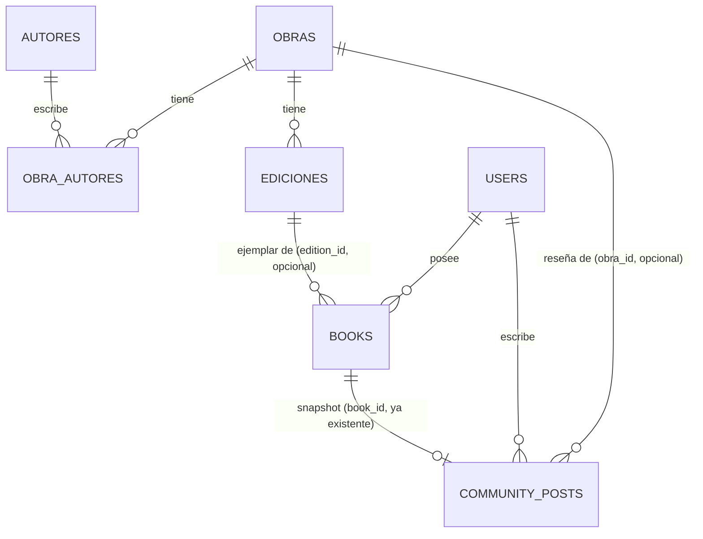

# Arquitectura del catálogo bibliográfico público — diseño (Fase 2)

Estado: **propuesta, no implementada.** Nada de este documento se ejecutó contra la base de
datos. Continúa la auditoría de 2026-10-21 (ver memoria del proyecto) y el arreglo del modo
invitado de solo lectura, ya aplicados localmente.

## 1. Esquema actual (comprobado, no inventado)

```sql
-- server/schema.sql, tabla books (tal cual existe hoy)
books (
  id UUID PK,
  user_id UUID NOT NULL REFERENCES users(id) ON DELETE CASCADE,
  title TEXT NOT NULL,
  author TEXT,              -- texto libre, no normalizado
  cover TEXT,                -- URL hotlink a covers.openlibrary.org, no se descarga
  publisher TEXT,
  genre TEXT,
  isbn TEXT,                 -- texto libre, sin validar, sin índice, no obligatorio
  pages INTEGER,
  year INTEGER,
  score, notes, start_date, end_date, color,
  total_pages, current_page,
  created_at, updated_at,
  would_reread BOOLEAN
)
```

Hallazgos relevantes para el diseño:

- **No hay ninguna entidad bibliográfica compartida.** Cada fila de `books` es 100% propiedad de
  un usuario, con todos los metadatos del libro repetidos como texto libre. Dos usuarios con el
  mismo libro tienen dos copias de texto completamente independientes, sin relación en la DB.
- **`isbn` no está indexado ni validado** — puede estar vacío, mal tipeado, o repetido entre
  usuarios sin que la base lo note.
- **La integración con Open Library es solo de nivel "obra".** Confirmé en
  `src/hooks/useBookSearch.ts` que `FIELDS` pide `key,title,author_name,publisher,cover_i,
  first_publish_year,language` contra `/search.json`, y ese `key` es el *work key* de Open
  Library (`/works/OL...W`), no un *edition key* (`/books/OL...M`). `searchByISBN` también pega
  contra `/search.json?isbn=...`, que resuelve a la obra, no a una edición específica. Es decir:
  **hoy no se guarda ningún identificador de edición de Open Library en ningún lado**, ni en
  `books` ni en memoria — la búsqueda por ISBN funciona para autocompletar, pero no deja rastro
  vinculable.
- **`community_posts` ya separa correctamente "ejemplar personal" de "contenido público"**: guarda
  un *snapshot* de `book_title/book_author/book_cover/book_score` en el momento de compartir,
  desacoplado de `books` vía `book_id UUID REFERENCES books(id) ON DELETE SET NULL`. Si el usuario
  edita o borra el libro después, la reflexión pública no se rompe. Este patrón es bueno y lo
  reutilizo en el diseño nuevo en vez de inventar uno distinto.
- **Qué depende de la forma actual de `books`:** `server/routes/books.js` (CRUD completo),
  `server/routes/community.js` (lee `title/author/cover/score` al crear un post),
  `src/hooks/useBooks.ts`, `src/components/BookCard.tsx`, `BookModal.tsx`, `BookDetailModal.tsx`,
  `StatsModal.tsx` (estadísticas calculadas sobre `genre`/`author` en texto libre). **Riesgo de
  tocar la forma de esta tabla:** altísimo — es el corazón de la app y de los tests existentes
  (`server/tests/books.test.js`, 60 tests totales hoy). Por eso el diseño de abajo no la modifica,
  solo la extiende.

## 2. Modelo de datos propuesto

Entidades conceptuales (no todas se vuelven tabla aparte — ver justificación por entidad):

| Concepto | ¿Tabla nueva? | Por qué |
|---|---|---|
| Obra | `obras` | Necesita existir independiente de cualquier edición o copia de usuario |
| Edición | `ediciones` | Un ISBN/edición concreta, distinta entre sí aunque sea "el mismo libro" |
| Autor | `autores` + `obra_autores` | Relación muchos-a-muchos real (una obra, varios autores; un autor, varias obras) |
| Ejemplar personal | **se queda siendo `books`** | Ya existe, ya tiene todo lo personal (notas, fechas, puntaje). Se le agrega un link opcional, no se reemplaza |
| Reseña pública | **se queda siendo `community_posts`** | Ya es "reflexión pública sobre un libro leído", con snapshot y moderación funcionando. Se le agrega un link opcional a `obras` para poder agregarlas por obra |
| Publicación de intercambio | *(fuera de esta fase)* | Se menciona el enganche al final, no se diseña en detalle — explícitamente pedido así |

```sql
-- Nuevo, aditivo, no toca nada existente
CREATE TABLE obras (
  id               UUID PRIMARY KEY DEFAULT gen_random_uuid(),
  canonical_title  TEXT NOT NULL,
  subjects         TEXT[],              -- géneros/materias de OpenLibrary, lista libre (no vale
                                         -- la pena una tabla de géneros normalizada: OL los da
                                         -- como texto suelto, no como taxonomía cerrada)
  first_publish_year INTEGER,
  ol_work_key      TEXT,                -- '/works/OL45804W' — NULL en obras cargadas a mano
  source           TEXT NOT NULL DEFAULT 'manual', -- 'openlibrary' | 'manual'
  created_at       TIMESTAMPTZ DEFAULT NOW(),
  updated_at       TIMESTAMPTZ DEFAULT NOW()
);
CREATE UNIQUE INDEX obras_ol_work_key_uq ON obras (ol_work_key) WHERE ol_work_key IS NOT NULL;

CREATE TABLE autores (
  id         UUID PRIMARY KEY DEFAULT gen_random_uuid(),
  name       TEXT NOT NULL,
  ol_author_key TEXT,                   -- '/authors/OL...A'
  created_at TIMESTAMPTZ DEFAULT NOW()
);
CREATE UNIQUE INDEX autores_ol_key_uq ON autores (ol_author_key) WHERE ol_author_key IS NOT NULL;

CREATE TABLE obra_autores (
  obra_id  UUID NOT NULL REFERENCES obras(id) ON DELETE CASCADE,
  autor_id UUID NOT NULL REFERENCES autores(id) ON DELETE CASCADE,
  PRIMARY KEY (obra_id, autor_id)
);
CREATE INDEX obra_autores_autor_idx ON obra_autores (autor_id);

CREATE TABLE ediciones (
  id             UUID PRIMARY KEY DEFAULT gen_random_uuid(),
  obra_id        UUID NOT NULL REFERENCES obras(id) ON DELETE CASCADE,
  title          TEXT,                  -- puede diferir del título canónico de la obra
  isbn_13        TEXT,
  isbn_10        TEXT,
  publisher      TEXT,
  publish_year   INTEGER,
  language       TEXT,                  -- código de idioma si Open Library lo da
  pages          INTEGER,
  cover_url      TEXT,                  -- hotlink, igual que hoy — no se descarga ni rehostea
  ol_edition_key TEXT,                  -- '/books/OL...M'
  source         TEXT NOT NULL DEFAULT 'manual',
  created_at     TIMESTAMPTZ DEFAULT NOW(),
  updated_at     TIMESTAMPTZ DEFAULT NOW()
);
CREATE UNIQUE INDEX ediciones_ol_key_uq  ON ediciones (ol_edition_key) WHERE ol_edition_key IS NOT NULL;
CREATE UNIQUE INDEX ediciones_isbn13_uq  ON ediciones (isbn_13)        WHERE isbn_13 IS NOT NULL;
CREATE UNIQUE INDEX ediciones_isbn10_uq  ON ediciones (isbn_10)        WHERE isbn_10 IS NOT NULL;
CREATE INDEX ediciones_obra_idx ON ediciones (obra_id);

-- Extensión aditiva de lo que ya existe — mismo patrón que `would_reread`/`display_name`
ALTER TABLE books ADD COLUMN IF NOT EXISTS edition_id UUID REFERENCES ediciones(id);
ALTER TABLE community_posts ADD COLUMN IF NOT EXISTS obra_id UUID REFERENCES obras(id);
```

### Diagrama de relaciones



Reglas clave:

- **Una obra puede tener N ediciones.** Una edición pertenece a una sola obra (`obra_id NOT NULL`).
- **Una edición puede estar en N bibliotecas de usuarios distintos** — `books.edition_id` no es
  único, varios `books` de usuarios distintos pueden apuntar a la misma edición.
- **`books.edition_id` es NULLABLE y así se queda para siempre como caso válido.** Un libro
  cargado a mano, o cuya edición no se pudo determinar con certeza, simplemente no tiene link —
  exactamente como se comporta cada fila de `books` hoy. **No hay backfill obligatorio ni fecha
  límite para completarlo.**
- Lo personal (notas, fechas de lectura, puntaje, estado) **se queda en `books` para siempre** —
  nunca se mueve a `ediciones` ni a `obras`. El catálogo público nunca expone esas columnas.

## 3. Integración con Open Library

### Vinculación de lo que ya existe

No hay fusión automática masiva. El vínculo se arma hacia adelante, de a uno, con reglas
explícitas de certeza:

| Caso | Identificador de certeza | Acción |
|---|---|---|
| Tiene `ol_edition_key` (vendría de una búsqueda/escaneo mejorado, ver abajo) | Máxima | Matchear/crear edición por ese key |
| Tiene ISBN-13 o ISBN-10 válido, sin `ol_edition_key` | Alta | Normalizar (sin guiones/espacios, calcular la otra forma de ISBN cuando el checksum lo permite) y matchear por ISBN |
| Tiene `ol_work_key` (así es la integración actual) pero no ISBN ni edition key | Media — solo a nivel obra | Matchear/crear **obra** por ese key; la edición queda sin determinar (`edition_id = NULL`) hasta que haya más certeza |
| No tiene ningún identificador de Open Library (carga 100% manual) | Ninguna | Se crea una obra+edición nuevas con `source = 'manual'`, **nunca** se intenta adivinar a cuál obra existente corresponde por similitud de texto |

**Nunca se fusiona por similitud de título/autor en texto libre.** "Cien años de soledad" vs "Cien
Años De Soledad" vs una traducción con otro título quedan como registros separados hasta que haya
un identificador real (ISBN o key de Open Library) que los una, o — en una fase futura, fuera de
alcance ahora — una herramienta de administración para fusionar a mano con revisión humana.

### Brecha técnica real a resolver

Hoy la búsqueda (`useBookSearch.ts`) solo trae datos de **obra**, nunca de edición. Para que
`ediciones.isbn_13`/`ol_edition_key` se puedan poblar con confianza al momento de agregar un
libro (no en un backfill posterior), se necesita un fetch adicional, solo cuando aplica:

- **Flujo de escaneo ISBN** (`ISBNScanner.tsx`) ya tiene un ISBN real del momento del escaneo →
  se puede resolver una edición concreta vía `GET https://openlibrary.org/isbn/{isbn}.json`
  (gratis, sin key, respeta cache-friendly: un fetch puntual al agregar, no en cada vista).
- **Flujo de búsqueda por texto** (`BookSearchModal.tsx`) solo trae el *work*. Se guarda el
  `ol_work_key` en `obras` y se deja `ediciones` sin `ol_edition_key` (pero sí con los datos
  sueltos que ya trae el doc de búsqueda: `publisher[0]`, `first_publish_year`, `cover_i` →
  alcanza para una edición "mejor estimación", marcada igual con `source = 'openlibrary'` pero sin
  ISBN hasta que alguien la complete a mano o la vuelva a resolver por ISBN más adelante).
- **Carga manual** sin ningún dato externo → obra + edición `source = 'manual'`, como ya se
  describió.

### Evitar pegarle a la API en cada vista

Una vez que una obra/edición quedó guardada en `obras`/`ediciones` (al momento en que *alguien*
la agrega por primera vez), **ver su ficha pública nunca vuelve a llamar a Open Library** — se
sirve desde la base local. Open Library solo se consulta: (a) durante el autocompletado de
búsqueda mientras el usuario tipea (como ya pasa hoy, en el navegador), y (b) en el momento puntual
de agregar un libro nuevo, para resolver la edición. Esto ya cumple el límite de uso razonable de
Open Library sin necesidad de un proxy de caché en el backend.

### Términos de uso

Los datos bibliográficos de Open Library son CC0 (dominio público) — no hay problema legal en
guardarlos en nuestra base. Las portadas se siguen sirviendo por **hotlink** a
`covers.openlibrary.org` (como ya hace la app hoy) en vez de descargarlas y rehostearlas: evita
costos de almacenamiento y queda dentro del uso esperado de su servicio de imágenes.

No hay necesidad de agregar Google Books ni ninguna otra fuente en esta fase — Open Library ya
cubre el caso de uso y agregar una segunda fuente ahora sería complejidad sin un problema concreto
que la justifique.

## 4. Plan de migración segura

**Nada de esto se ejecuta en esta sesión.** Se presenta para su revisión.

1. **Backup antes que nada.** `pg_dump` completo de la base de producción antes de aplicar
   cualquier cambio de esquema. Comando a ejecutar (por vos o con tu autorización explícita, vía
   SSH al VPS): `pg_dump "$DATABASE_URL" -F c -f haiku_backup_$(date +%Y%m%d).dump`.
2. **Paso aditivo único.** Las sentencias de la sección 2 (`CREATE TABLE ... obras/autores/
   obra_autores/ediciones`, más los dos `ALTER TABLE ... ADD COLUMN IF NOT EXISTS`) son 100%
   aditivas: crean tablas nuevas y agregan columnas nullable a tablas existentes. **No se
   modifica, renombra ni borra ninguna columna existente.** Sigue exactamente el patrón que ya usa
   `schema.sql` para `would_reread` y `display_name` — mismo estilo, mismo nivel de riesgo (bajo).
3. **Verificación post-migración:** `SELECT COUNT(*) FROM books` antes y después debe dar el mismo
   número (tiene que ser trivialmente cierto, porque la migración no toca filas de `books`, pero
   se verifica igual). Smoke test: `GET /books` con un token real debe devolver exactamente los
   mismos libros que antes, con `edition_id: null` en todos.
4. **Backfill — opcional, separado, no bloqueante.** Un script aparte (ej.
   `server/scripts/backfill-editions.js`, no un endpoint HTTP) que recorre `books` con `isbn IS
   NOT NULL AND edition_id IS NULL`, resuelve contra Open Library con una demora entre pedidos
   (buena práctica con su API gratuita), y solo escribe `edition_id` cuando hay certeza (ISBN
   normalizado coincide). Se corre cuando vos decidas, se puede parar y repetir sin romper nada —
   cada fila que no se pudo resolver se queda en `NULL`, que es el estado válido por defecto.
5. **Convivencia de rutas.** No hace falta convivencia "vieja vs nueva" en el sentido estricto:
   `server/routes/books.js` y `community.js` **no cambian su contrato actual**, solo empiezan a
   aceptar un campo opcional más (`editionId`). Las rutas nuevas (`/catalog/*`, sección 6) son
   agregados, no reemplazos.
6. **Criterio de reversión.** Como el paso 2 es puramente aditivo, revertir es de bajo riesgo:
   `DROP TABLE ediciones, obra_autores, autores, obras CASCADE;` y
   `ALTER TABLE books DROP COLUMN IF EXISTS edition_id; ALTER TABLE community_posts DROP COLUMN IF
   EXISTS obra_id;`. Ningún dato de `books` o `community_posts` original se pierde en ningún
   escenario — la reversión solo elimina las tablas/columnas nuevas, nunca toca una columna que ya
   existía antes de esta fase.

## 5. Acceso público y privacidad

- Rutas nuevas de **solo lectura, sin `auth`**: exploran `obras`/`ediciones`/`autores` y las
  reseñas públicas ya existentes (`community_posts`, que ya son públicas por diseño desde que se
  construyó la sección Comunidad). **Nunca** se expone `books` (el ejemplar personal) a través de
  estas rutas — ni directamente ni en un JOIN. Como mucho, un conteo agregado tipo "N personas en
  Haiku tienen este libro" (`COUNT(*)`), nunca una lista de quiénes.
- Ninguna ruta de escritura (`POST`/`PUT`/`DELETE`) deja de requerir `auth` — un visitante sin
  cuenta puede leer el catálogo pero no puede agregar libros a una biblioteca, dejar reseñas ni
  tocar nada autenticado. Esto es una extensión directa de los permisos que ya existen hoy
  (`auth` + chequeo de `user_id` en cada escritura), no un modelo de permisos nuevo.
- **Las bibliotecas personales no se vuelven públicas por esta fase.** Hoy no existe ningún
  concepto de "biblioteca pública" — y esta fase no lo introduce. Lo único que se expone
  públicamente son las reseñas que un usuario ya decidió compartir activamente en Comunidad (igual
  que hoy) y el catálogo bibliográfico compartido (que es información de los libros, no de las
  personas). Si en una fase futura se quiere mostrar "la biblioteca de fulano", eso necesita un
  flag de visibilidad explícito por biblioteca/colección — **no está en esta fase y no debería
  asumirse por defecto en ningún caso.**
- **Modo invitado compartido** (hallazgo de la auditoría inicial): ya se corrigió esta sesión —
  ahora es de solo lectura (`server/middleware/blockDemoWrites.js`), lo cual **también resuelve**
  el riesgo de que contenido generado por invitados contamine el catálogo público nuevo, porque ya
  no puede escribir libros ni reseñas. No hace falta ningún cambio adicional sobre el modo
  invitado para esta fase.

## 6. API y frontend

### Endpoints nuevos (solo lectura, sin auth)

```
GET /catalog/works?q=&limit=&cursor=       → buscar obras ya presentes en el catálogo local
GET /catalog/works/:id                      → ficha pública: obra + autores + ediciones +
                                               reseñas públicas (community_posts.obra_id = :id)
                                               + conteo de bibliotecas que lo tienen
GET /catalog/editions/:id                   → detalle de una edición puntual
GET /catalog/authors/:id                    → obra de un autor (se puede diferir, baja prioridad)
```

La búsqueda del catálogo público es **local-first**: busca en `obras`/`ediciones` ya importadas
por la propia comunidad de Haiku (rápido, gratis, sin llamadas externas). Si no hay resultados
locales, se puede ofrecer una sección aparte y claramente distinguida "Buscar también en Open
Library" que reutiliza `useBookSearch.ts` tal cual existe — pero dejando visualmente claro que esos
resultados externos todavía no tienen reseñas ni están en ninguna biblioteca de Haiku, para no
prometer una cobertura que no existe.

### Endpoints existentes, extendidos (no duplicados)

- `POST /books` y `PUT /books/:id` (`server/routes/books.js`) aceptan un campo opcional
  `editionId` además de los campos actuales. Si viene, se guarda en `books.edition_id` tras
  validar que la edición existe. El resto del contrato no cambia.
- `POST /community/posts` puede completar `obra_id` automáticamente tomando
  `books.edition_id → ediciones.obra_id` del libro que se está compartiendo, cuando exista.

No se duplican rutas ni se crea un segundo CRUD de libros — todo lo de escritura sigue viviendo en
las rutas actuales.

### Navegación pública en el frontend

Hoy `App.tsx` no tiene ningún router — todo es estado en memoria (`!user` → login, si no →
biblioteca). Para que el catálogo público tenga URLs reales, indexables y compartibles (pedido
explícito de la sección de SEO del prompt original), **hace falta introducir ruteo por URL**, que
hoy no existe. Esto es una decisión de arquitectura nueva, no un detalle de implementación —
la marco como pendiente de tu confirmación en la sección de riesgos (§8), con `react-router-dom`
(MIT, liviano, estándar) como la opción recomendada en vez de armar un router casero.

Diseño de las páginas nuevas, reusando patrones ya existentes en `LibraryPage.tsx`:
- Grilla paginada (mismo patrón que `ITEMS_PER_PAGE`/`Pagination` ya implementado).
- Estados de carga, vacío y error siguiendo las clases `.loadingState`/`.errorState` ya definidas.
- Mobile-first, mismos breakpoints (`@media (min-width: 480px)`) que el resto de la app.
- Sin tocar la experiencia de usuarios logueados — la biblioteca personal sigue siendo la pantalla
  principal después de iniciar sesión, el catálogo público es una sección nueva, no un reemplazo.

## 7. Pruebas de aceptación (a implementar junto con el código, no en esta entrega)

Siguiendo el estilo ya usado en `server/tests/` (Jest + Supertest):

- Los libros existentes se preservan: conteo de `books` antes/después de la migración es idéntico.
- Una obra puede tener múltiples ediciones (insertar 2 ediciones con el mismo `obra_id`, ambas
  aparecen en la ficha pública).
- Una edición puede estar en bibliotecas de usuarios distintos (2 filas de `books` con el mismo
  `edition_id`, de `user_id` distintos).
- Las bibliotecas no se mezclan entre usuarios — reconfirmar que `GET /books` sigue filtrando por
  `user_id` después del cambio (ya cubierto hoy, se vuelve a correr tras tocar la ruta).
- Un visitante sin token puede `GET /catalog/works` y `GET /catalog/works/:id`.
- Un visitante sin token sigue recibiendo 401 en cualquier escritura (`POST`/`PUT`/`DELETE` de
  `/books`, `/community`, `/settings` — ya cubierto, se reconfirma que nada quedó expuesto).
- Un usuario no puede fijar `edition_id` en un libro ajeno (mismo chequeo `WHERE user_id = $` que
  ya protege el resto de los campos).
- Dos obras manuales con el mismo título no se fusionan automáticamente — quedan como dos filas
  con `id` distinto.
- La integración con Open Library maneja: 0 resultados (estado vacío, no rompe), error de red o
  5xx (mensaje de error claro, no crashea la UI) — mockeando `fetch` como ya hacen los tests de
  `useBookSearch`.

## 8. Riesgos y decisiones que necesitan tu autorización

1. **Introducir un router de frontend** (`react-router-dom` u otra librería liviana) — es una
   dependencia nueva y un cambio de arquitectura en cómo navega toda la app, no solo el catálogo.
   Sin esto, el catálogo público no puede tener URLs indexables por buscadores.
2. **Alcance de la búsqueda pública**: ¿catálogo local-first con fallback a Open Library (como
   propongo), o restringir la búsqueda pública solo a lo que ya está en Haiku? Afecta cuánto
   "poder de descubrimiento" tiene un visitante sin cuenta desde el día uno.
3. **Cuándo correr el backfill de ediciones** (paso 4 del plan de migración) — es opcional y no
   bloqueante, pero toca la API externa en lote; mejor decidir el momento con vos en vez de
   dejarlo automático.
4. **Ejecutar la migración aditiva en producción** (sección 4, paso 2) — es de bajo riesgo según
   el análisis, pero sigue siendo un cambio de esquema en la base de producción, así que no se
   aplica sin tu ok explícito, con el backup corrido antes.

No se tocó nada del esquema de producción en esta entrega. Quedo a la espera de tu revisión antes
de implementar cualquier parte de esto.
